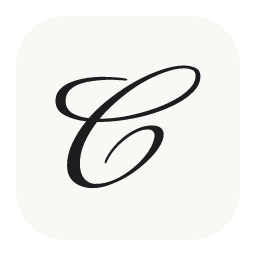
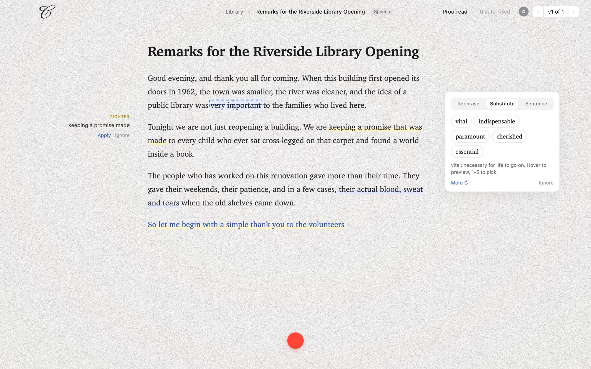

<p align="center"></p>

# Cader

A desktop app for writing blogs and speeches by voice. Dictate, then proofread, rephrase, swap in stronger words and try other ways of saying each sentence. Every review pass is saved as a version. All models run locally on your Mac; nothing leaves the machine.



## Features

- **Dictation:** press the record button and speak; Whisper (large-v3-turbo, via whisper.cpp) transcribes on device.
- **Proofread:** grammar, spelling and dictation clean-up (filler words, repeated words, missing punctuation), each issue with its reason. Obvious misspellings are fixed automatically and can be undone.
- **Rephrase and Substitute:** select a span to get rewrites that fit the sentence, or stronger, more precise words with a note on each.
- **Sentence alternatives:** rest the caret in a sentence to see other ways of saying it, with the changed words in bold. Pin the ones you like and ask for more.
- **Versions:** Save closes a review and keeps the text as a new version. The Versions panel shows a word diff against any earlier version, and any version can be restored.
- **Export:** copy, Markdown, plain text, and for speeches a large-type reading view and PDF.

## Models

| Task | Model | Runtime |
| --- | --- | --- |
| Dictation | Whisper large-v3-turbo (1.6 GB) | whisper.cpp (whisper-rs) |
| Proofread and grammar | grammarly/coedit-large (0.8 GB) | ONNX Runtime (ort) |
| Rephrase, substitute, alternatives | Qwen2.5-14B-Instruct Q4_K_M (9.0 GB) | llama.cpp with Metal (llama-cpp-2) |

The models are downloaded from Hugging Face on first use, checksummed, and cached in `~/Library/Application Support/app.cader.desktop/models`. The suggestion model needs about 10 GB of memory; it was built and measured on an M2 Max with 64 GB.

CoEdIT-large is licensed CC-BY-NC-4.0, which allows personal, non-commercial use only.

## Build

Requires macOS on Apple Silicon, [Rust](https://rustup.rs), [Bun](https://bun.sh) and the Xcode command line tools.

```bash
bun install
```

```bash
bun run dev
```

```bash
bun run build
```

Documents are stored as plain files in `~/Cader` (one folder per document, with its saved versions).

## Tests

```bash
bun test ui
```

```bash
cd src-tauri && cargo test
```

The model tests are ignored by default; run them with the models downloaded:

```bash
cd src-tauri && CADER_MODELS="$HOME/Library/Application Support/app.cader.desktop/models" cargo test --release -- --ignored
```

## Specs

Specs, questions and decisions live on the Spill board in [`.spill/`](.spill/).
